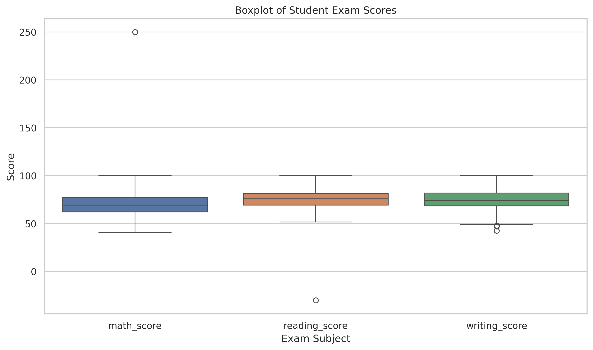
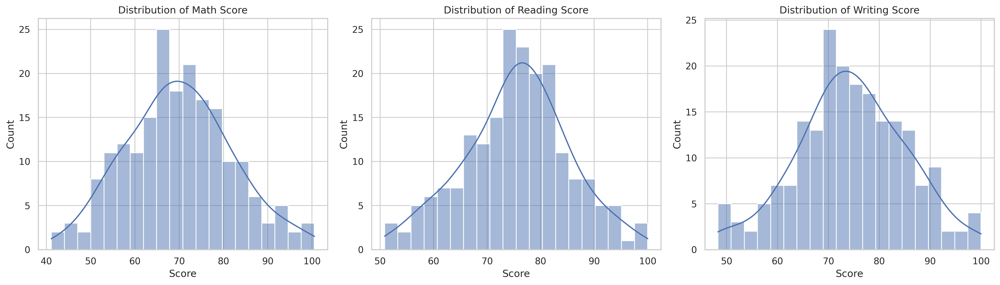
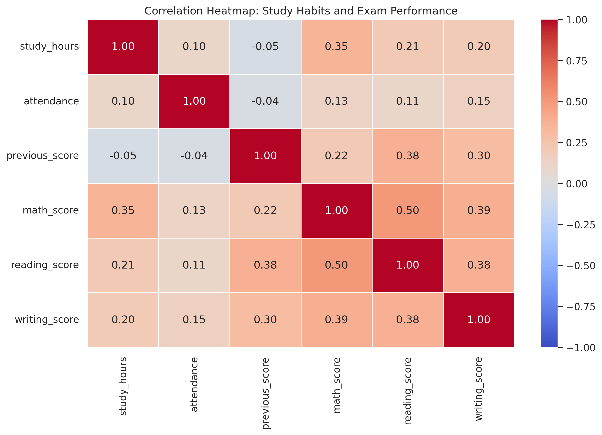

# Student-Exam-Performance-Data-Visualizer
##GetIntern Week-3

### Objective
To analyze student exam scores, identify potential outliers, explore score distributions, and examine correlations between study-related features and academic performance.

### Tools and Libraries
- Python
- Pandas and NumPy
- Seaborn and Matplotlib
- Google Colab

### Methodology
1. Created and explored a student performance dataset.
2. Generated boxplots for Math, Reading, and Writing scores.
3. Calculated IQR bounds and identified potential outliers.
4. Capped extreme score values using IQR-based limits.
5. Visualized score distributions using histograms and KDE curves.
6. Compared Math score distributions across study-hour groups.
7. Calculated numerical correlations and plotted an annotated heatmap.

### Visual 1: Boxplot
**File:** `boxplot.png`

- The boxplots summarize score medians, quartiles, and potential outliers.
- Extreme values are identified using the 1.5 × IQR rule.
- Capping limits the influence of extreme scores while retaining student records.
- 

### Visual 2: Distribution Plot
**File:** `distribution_plot.png`

- Histograms and KDE curves show how exam scores are distributed.
- Comparing subjects helps reveal differences in score concentration and spread.
- The study-hour breakdown illustrates how score distributions can be compared across groups.
  

### Visual 3: Correlation Heatmap
**File:** `heatmap.png`

- The annotated heatmap displays linear correlation coefficients between numerical features.
- The strongest positive associations can be identified by examining study variables against exam scores.
- Correlation describes association and does not establish causation.
  

### Conclusion
This project demonstrates outlier detection, IQR-based capping, distribution analysis, and correlation visualization using Python. The results illustrate how visual analytics can help explore data quality and potential relationships in student performance data.

### Dataset Note
The dataset is synthetically generated for educational purposes. It is not real student data, and the findings should not be treated as evidence about actual students.

